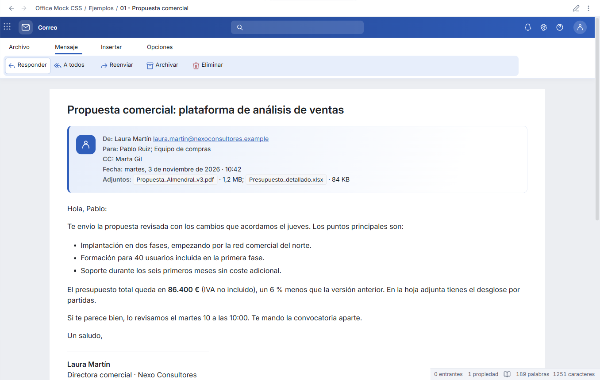
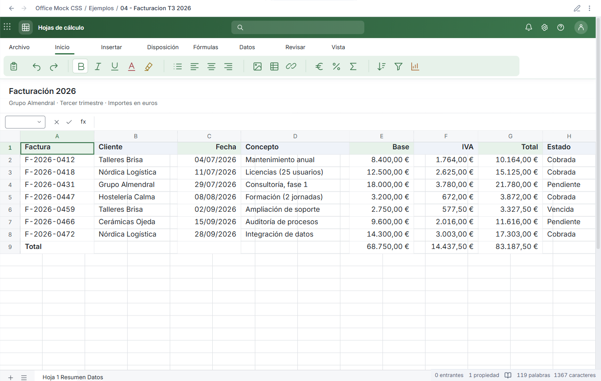

# Office Mock

An office-inspired Obsidian theme with document, email, meeting and spreadsheet views. Notes stay ordinary Markdown; no plugin is required.


**A visual theme, with native editing.** The ribbons, search box and formula bar are decorative. Typing, text selection, table cells, links, undo and saving are provided by Obsidian. This theme does not calculate spreadsheet formulas, send emails or schedule meetings.

## Example screenshots

The included Markdown examples, rendered in Obsidian.

### Email



[Markdown example](examples/01%20-%20Propuesta%20comercial.md) · [Dark mode](images/email-dark-preview.png)

### Spreadsheet



[Markdown example](examples/04%20-%20Facturacion%20T3%202026.md) · [Live Preview editing in dark mode](images/spreadsheet-dark-source.png)

## Install

Until the theme is listed in Community Themes:

1. Download `Office-Mock-1.0.1.zip` from the [latest release](https://github.com/DavidHurtadoAI/obsidian-office-mock/releases/latest).
2. Copy the extracted `Office Mock` folder into your vault's `.obsidian/themes/` folder. It must contain `theme.css` and `manifest.json` directly.
3. Open **Settings → Appearance → Themes** and select **Office Mock**. Restart Obsidian if the new local theme is not yet listed.
4. Copy the optional `examples` and `templates` folders into your vault.
5. If you used the earlier snippet, disable `office-clean` before selecting the theme.

Requires Obsidian 1.5.0 or newer and an installer using Chromium 114 or newer. Reading view and **Live Preview** are supported; Source mode remains a native Markdown editor. The theme uses your configured text, interface and monospace fonts and your text size.

## Choose a view

Ordinary Markdown notes use the document view. Add a class in frontmatter to choose another view:

| `cssclasses` value | Appearance |
| --- | --- |
| `office-document` | Blue document page, also the default |
| `office-email` | Blue email window and sender card |
| `office-meeting` | Purple meeting window and invitation card |
| `office-spreadsheet` | Green spreadsheet with editable native tables |
| `office-plain` | Native note layout with the theme's general colors |

```yaml
---
cssclasses:
  - office-email
---
```

Other custom classes and an empty `cssclasses` property do not disable the document default. Use `office-plain` when you want a native note layout. This avoids inspecting the Properties DOM and works with properties visible, hidden or shown as YAML.

Start the body with a normal `# Heading`. For email and meeting notes, put the real header data in an ordinary blockquote immediately below it. The examples show sender, recipients, CC, attachments, date, organizer and location. These fields remain readable without the theme; no HTML, UI callouts or dummy rows are needed. Attachment names in the supplied examples are fictional labels, not bundled files.

## Edit

Select **Live Preview** in Settings → Editor. Click text or a native table cell to type. In cells, `Tab` commits and advances; `Shift+Tab` goes back. Use Obsidian's native table controls or context menu to add rows and columns. Changes are saved in the same Markdown file.

Both the application interface and document surfaces support light and dark modes. Ribbons retain their application colors. On narrow panes, secondary ribbon tools are clipped while wide data tables scroll horizontally. Printing hides decorative ribbons.

| View | Light | Dark |
| --- | --- | --- |
| Document | [Preview](images/document-light-preview.png) | [Preview](images/document-dark-preview.png) |
| Email | [Preview](images/email-light-preview.png) | [Preview](images/email-dark-preview.png) |
| Meeting | [Preview](images/meeting-light-preview.png) | [Preview](images/meeting-dark-preview.png) |
| Spreadsheet | [Preview](images/spreadsheet-light-preview.png) | [Editing](images/spreadsheet-dark-source.png) |

The decorative ribbon labels are currently Spanish. The native interface follows Obsidian's language. The sample notes contain fictional Spanish business data.

## Compatibility and scope

This is an independent theme. It does not require a parent theme, runtime JavaScript, Style Settings, an account, remote fonts or network resources. Screenshots and automated QA are captured from Obsidian on Windows; narrow viewport checks are emulation, not physical iOS/Android certification.

See [validation](docs/VALIDATION.md) and [community submission status](docs/COMMUNITY.md). A GitHub release does not mean the theme has been accepted into Community Themes.

[Guía en español](docs/README.es.md)

## Development

```sh
npm ci
npm run check
npm run package
```

`src/base.css` defines native interface tokens. `src/office.css` defines the document views and embedded icon geometry. `scripts/build.mjs` produces `theme.css`, removes obsolete snippet workarounds, creates dark assets, orders selectors by specificity and applies the official Stylelint formatting rules. Commit the generated CSS together with source changes.

The check uses the unmodified `stylelint-config-obsidianmd`, plus a Chromium 114 compatibility check, manifest/license/content checks and color contrast checks. No lint rules are disabled. Runtime code is never distributed with the theme.

Optional native integration QA requires an open **@Nexus-dev** development vault with a local debugging endpoint. See [CONTRIBUTING.md](CONTRIBUTING.md). It is not run by the theme or on installation.

## License and credits

Theme code: [MIT](LICENSE), David Hurtado. Based on the Office Demo design system supplied for this project. Lucide and Feather-derived icons retain their ISC/MIT notices in [THIRD_PARTY_NOTICES.md](THIRD_PARTY_NOTICES.md).

Office Mock is an independent project and is not affiliated with Microsoft or Obsidian.
